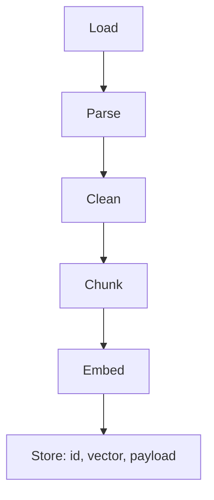
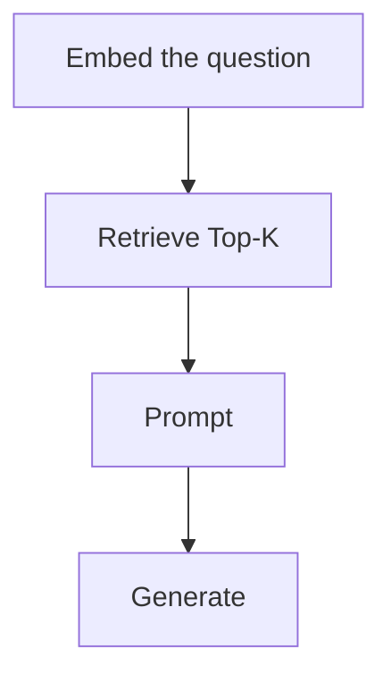
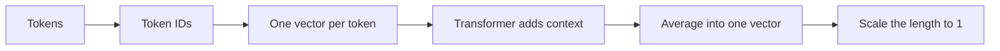
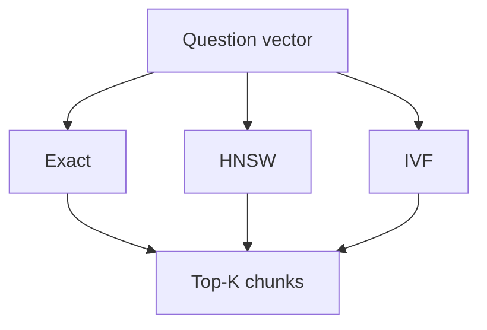

# RAG cheat sheet

The basic pipeline, from documents to a grounded answer. Frameworks are left out.

For this repo’s files, settings, chunk counts, and the 17 October scores, see [PIPELINE_FLOW.md](PIPELINE_FLOW.md).

## What RAG is

Retrieval-Augmented Generation gives the model relevant text from an outside source before it writes. The retriever finds the text. The model writes the answer. The weights stay frozen.

A wrong retrieval still produces an answer, and it can look more sure because the model is writing from retrieved text.

| | RAG | Fine-tuning |
|---|---|---|
| Use it when | The model needs this information | The model should behave differently |
| What changes | The index, at question time | The weights, in a training run |
| A policy bot | Yes | Only if you also want a house style |

## Two pipelines

Ingestion runs when the documents, the chunking, or the embedding model change. Query runs for every question and only reads the index.

| Step | What it does |
|---|---|
| Load | Read each file. Keep the file name. It becomes the chunk’s source. |
| Parse | Turn the file into text and keep its structure. Read a few parsed pages before chunking. A bad column, table, or page order is inherited by every later chunk. |
| Clean | Drop headers, footers, and other junk the parser left in. |
| Chunk | Split into retrieval units. Each chunk gets its own vector. |
| Embed | One vector per chunk, from the same model the query will use. |
| Store | A point is an id, a vector, and a payload. The same id updates that point. The payload holds the chunk text and the metadata that citations, filters, and access checks read. |

| Step | What it does |
|---|---|
| Embed the question | Same model as ingestion. Some models also want a query prefix, such as `search_query:`. |
| Retrieve | Compare the question vector with stored vectors. Return the Top-K nearest chunks. |
| Prompt | Rules, then the chunks with their source labels, then the question. |
| Generate | The model answers from that prompt. The index is not written to. |

Both sides meet at the vector database. A vector from one model cannot be compared with a vector from another.

## Chunking

A chunk is the piece that gets one vector and can be pasted into the prompt. These are the usual ways to cut a document:

| Type | How it cuts |
|---|---|
| Fixed window | Every N characters or tokens, with an overlap so a sentence on the boundary is not lost. |
| Sentence or paragraph | Break on those boundaries, then group pieces until the chunk reaches the size limit. |
| Heading | One section per chunk. A long section is cut again only at a sentence or line end. |
| Recursive | Try a paragraph break first, then a sentence, then a word, and stop at the first cut that fits the size. |
| Semantic | Compare neighboring sentences and cut where the topic changes. |

| Size | What goes wrong |
|---|---|
| Too small | The answer is split across pieces that mean little alone, so retrieval misses it. |
| Too large | The matching sentence is buried, and every extra token is sent to the model. |

Start with headings when the document has them, and cut a long section only at a sentence or line end. Overlap matters when a cut can slice a sentence. If every chunk already starts and ends on a complete thought, overlap can stay at 0.

Put the document title and the section heading into the text that gets embedded, when the chunk body itself does not name the topic. Store the plain chunk in the payload. The prefix is for the embedding, not for the text the model is shown.

## Inside one embedding

One chunk goes in. One vector comes out. Similar meanings land near each other, and that closeness is what search uses.

| Step | What it does |
|---|---|
| Tokens | Split the text into pieces from a fixed vocabulary. Add a start marker and an end marker. |
| Token IDs | Each piece becomes a whole number. Nothing about meaning exists yet. |
| One vector per token | Each ID picks a row from a learned table. At this point, “bank” has the same numbers in every sentence. |
| Transformer adds context | Each token looks at the others. “Bank” beside “cash” ends up different from “bank” beside “river.” |
| Average into one vector | Mean-pool the token vectors. The chunk is now one list of numbers. |
| Scale the length to 1 | Many models resize that list so its length is exactly 1. This is the vector you store and search. |

**How the numbers were trained.** Matching texts, such as a question and its answer, are pulled together. Unrelated texts are pushed apart.

**Dimension.** How many numbers are in the vector. 768 and 1536 are counts, not features you can name. Each number is 4 bytes, so 1536 dimensions is about 6 KB per chunk before the text and the index. More dimensions are not automatically better. Shorten a vector only when memory or cost forces it, then re-check recall, and embed every chunk again at the new size.

**Same space.** The collection size must match the model. Changing the model means embedding every chunk again.

**Payload.** The vector cannot be read back as text. Source, section, and the chunk text live in the payload.

## Similarity

Set the collection to the metric the embedding model was trained for. For text, that is almost always cosine.

| Metric | Measures | Closer when | Use it for |
|---|---|---|---|
| Cosine | The angle. Length is ignored. | The score is higher | Documents and RAG. A long file should not lose for being long. |
| Euclidean | Straight-line distance between the endpoints. | The distance is lower | Pixels, coordinates, and other values where size is real. |
| Dot product | Angle and length together. | The score is higher | When a bigger vector should win. Same ranking as cosine if every vector has length 1. |
| Manhattan | The sum of the gaps on each axis. | The distance is lower | Noisy features, where one huge outlier should not dominate. |

OpenAI embeddings are already length 1, so cosine and dot product rank the same. Qdrant can normalise on insert and then use the cheaper dot product.

## Search

Search takes the question vector and returns the nearest stored chunks. By hand that is: compare it with every stored vector, rank them, and keep the best ones. A vector database does that same job. An index is only there for when comparing every vector is too slow.

### Top-K

K is how many of those chunks you pass to the model. A bigger K raises recall and lowers precision. The right chunk is more likely to be included, and so are chunks that do not help. The extra chunks also cost tokens. Models use the middle of a long context less reliably, so a longer prompt is not a better one by itself.

### Finding the neighbours

Pick one. Exact search compares every vector, so the ranking is complete. HNSW and IVF skip most vectors, so they can miss a true neighbour. That miss is the price of speed. More search effort finds more of the true neighbours and takes longer.

| | What it does | Use it when |
|---|---|---|
| Exact | Compares the question with every vector. | The collection is still small, around tens of thousands of chunks, or you need the true ranking to test an approximate index. |
| HNSW | Walks a layered graph from a coarse layer down to the nearest vectors. Building the links costs time and memory. New vectors can be added as they arrive. | A full scan is too slow. This is the usual index, including in Qdrant. |
| IVF | Groups vectors into clusters first, then searches only the clusters nearest the question. | Memory is tight and the documents barely change. The clusters are learned from data you already have, and they go stale as documents change. |

HNSW has three knobs:

| Knob | Set when | Raising it |
|---|---|---|
| `m` | The index is built | Gives each vector more links. Recall goes up, and so does memory. |
| `ef_construct` | The index is built | The builder looks at more candidates while choosing those links. Indexing is slower, and the graph is better. |
| `hnsw_ef` | Each query | Keeps more candidates alive during the search. Recall goes up, and the query is slower. |

IVF’s query knob is how many clusters to probe. Probing more of them raises recall and slows the query, the same trade as `hnsw_ef`.

### Two add-ons

Quantization and a payload filter do not replace the choice above. Turn one on when you can name the problem it solves.

| | What it does | Turn it on when |
|---|---|---|
| Quantization | Stores each number in fewer bits. The forms are scalar, product, and binary. | The index does not fit in memory. Re-check recall after you turn it on. |
| Payload filter | Searches only points whose payload matches, such as a tenant or a section, then takes Top-K. | One user must not see another tenant’s chunks, however similar the vectors are. Index the field you filter on. A very selective filter can make the search slower. |

### Checking an approximate index

`recall@K` is the share of an exact Top-K that the approximate Top-K also returned, on the same question. 1.00 means nothing was missed. If it is low, raise `hnsw_ef` or probe more clusters. If queries are slow, lower that effort.

## Eval

Score the chunks before you score the answer. A bad answer with good retrieval points at the prompt or the model. A bad retrieval score points at chunking, embeddings, or search.

Retrieval, at Top-K:

| Metric | Question it answers |
|---|---|
| Hit Rate | Did any expected section appear? |
| Recall | What share of the expected sections appeared? |
| Precision | Of the chunks you returned, how many were useful? |
| MRR | How high did the first correct chunk rank? |

Answer:

| Score | Question it answers |
|---|---|
| Correctness | Is the answer right? |
| Context support | Does the answer stay inside the retrieved chunks? |
| Completeness | Did it cover the parts the question needed? |
| Refusal | On an unanswerable question, did it say it cannot tell? |

Tune on a dev set of questions. Report the final number on a held-out set you did not tune on. A judge can wobble by a point or two on the same answer, so a 1–2% swing between runs is noise.

## Experiments

Change one step, then compare with the plain pipeline on the same questions. Changing chunking or the embedding model means ingesting again before you measure.

| | Name | What it does | Where |
|---|---|---|---|
| A | Query rewriting | The question is rewritten before it is embedded. | Before embed |
| B | Query expansion | Extra phrasings are searched, and the results are merged. | Before embed |
| C | Metadata filter | Only chunks that match a payload field are searched, such as section or tenant. | During search |
| D | Hybrid search | A keyword ranking is fused with the vector ranking. | During search |
| E | Reranking | A wider set is fetched, scored again, and cut back to Top-K. | After search |
| F | Diagnosis | The rank of a section is inspected. The pipeline does not change. | No change |
| G | Context compression | The retrieved text is shortened before the prompt. | After search, before the prompt |

Promote a winner into the real query path only when it is clearly better and worth the extra time. Then re-measure retrieval and answers, and treat those numbers as the new baseline.

Where each experiment plugs into this repo is in [PIPELINE_FLOW.md](PIPELINE_FLOW.md).
